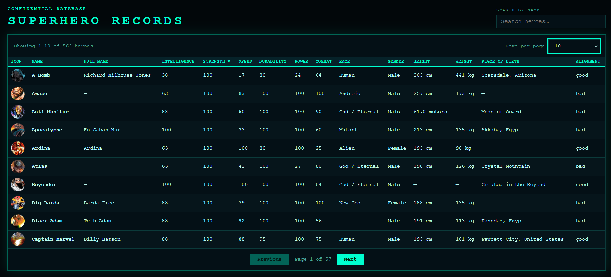

# Sortable

A browser-based superhero database: one sortable, searchable and paginated
table built from a public JSON file, with a detail view for every hero.
Written in plain HTML, CSS and JavaScript — **no frameworks, no libraries,
no build step**.



---

## Description

The page downloads the full hero list once with `fetch`, converts the
messy text values (heights like `"6'8"` / `"203 cm"`, weights like
`"90,000 tons"`) into numbers, and shows the result in a table that can be
sorted by any column, filtered with a live search, and browsed page by page.
Clicking a hero opens a dialog with the large picture and every detail.
The whole state — search text, sort column and open hero — is kept in the
URL, so a link always reopens exactly what you were looking at.

Data source:
[superhero-api `all.json`](https://rawcdn.githack.com/akabab/superhero-api/0.2.0/api/all.json)

---

## Features

- Table with 15 columns: icon, name, full name, six powerstats, race,
  gender, height, weight, place of birth and alignment
- **Sorting** on every column — click a header to sort ascending, click
  again for descending (an arrow shows the direction)
- Numbers are sorted as numbers, text alphabetically, and **missing values
  are always last**, whichever direction is chosen
- Weight and height are compared in real units: kilograms (`tons` → ×1000)
  and centimeters (`meters` → ×100)
- **Live search** by name, plus **field search with operators**
  (`race:human`, `race:!human`, `strength:>80`, `weight:<1000` — see below)
- **Pagination**: 10, 20 (default), 50, 100 or all results per page
- **Detail view**: click any hero to see the large image and all details
- **URL state**: search, sort, page, page size and open hero are stored in the address bar
- Dark "cyber HUD" theme; the table scrolls sideways on narrow screens
- Vanilla JavaScript only

---

## Requirements

- Any modern browser (Chrome, Firefox, Edge, Safari)
- Internet access (the data and the hero images are loaded from a CDN)
- A static file server to serve the folder — for example the one that ships
  with Python 3 or Node.js

---

## Installation & Usage

```bash
git clone https://platform.zone01.gr/git/spetridou/sortable
cd sortable

python3 -m http.server 8080
```

Then open `http://localhost:8080` in your browser.

Any other static server works too, for example `npx serve .`. Always start
the server from the project root (the folder that contains `index.html`).

---

## Search

Type in the search box — results update as you type. Plain text searches the
hero name. To search another column use `field:value`, and put an operator
in front of the value:

| You type | Meaning |
|---|---|
| `batman` | name contains "batman" |
| `race:human` | race contains "human" |
| `race:!human` | race does **not** contain "human" |
| `alignment:=good` | alignment is exactly "good" |
| `strength:>80` | strength greater than 80 |
| `strength:<30` | strength less than 30 |
| `strength:=100` or `strength:100` | strength equal to 100 |
| `strength:!=100` | strength not equal to 100 |
| `weight:>1000` | weight above 1000 kg |
| `height:<100` | height below 100 cm |
| `placeOfBirth:"new york"` | quotes keep a value with spaces together |
| `gender:female race:human strength:>50` | several conditions: all must match |

Rules:

- Field names are not case sensitive (`RACE:Human` works). Searchable fields:
  `name`, `fullName`, `intelligence`, `strength`, `speed`, `durability`,
  `power`, `combat`, `race`, `gender`, `height`, `weight`, `placeOfBirth`,
  `alignment`.
- `>` and `<` only make sense for numbers (powerstats, height, weight).
- A hero with a missing value never matches a positive condition, but does
  match `!` and `!=` (a hero without a race is "not human").
- Text that is not `field:value` with a known field is treated as a name
  search, and a field with no value yet (`race:`) is ignored while you type.

---

## URL State

The address bar always describes the current view:

```
?q=race%3Ahuman+strength%3A%3E90&sort=speed&dir=desc&hero=426
```

| Parameter | Meaning |
|---|---|
| `q` | search text |
| `sort` | sorted column (default `name`) |
| `dir` | `asc` or `desc` (default `asc`) |
| `hero` | id of the open hero |
| `page` | current page (default `1`) |
| `size` | rows per page: `10`, `20` (default), `50`, `100` or `all` |

Default values are left out, so the URL of a fresh page is clean. Copy theURL into another tab and the same table, sort and hero appear. Unknown
values in the URL are ignored. The page number is not stored.

---

## Project Structure

```
sortable/
├── index.html          page structure
├── README.md
├── docs/
│   ├── PRD.md          project requirements
│   └── tasks.txt       task split between the three coders
├── css/
│   └── style.css       theme and layout (colors live in CSS variables)
├── tests/
│   ├── load-app.js     loads the browser files in Node with a fake page
│   └── sortable.test.js  unit tests for parsing, sorting and search
└── js/
    ├── data.js         downloads the heroes and turns them into clean objects
    ├── table.js        draws the table rows, pagination and load errors
    ├── search-sort.js  search, operators and sorting
    ├── detail.js       hero detail dialog
    ├── url-state.js    keeps search, sort and open hero in the URL
    └── app.js          starts everything once the data is loaded
```

---

## How It Works

1. **Loading** — `data.js` fetches `all.json` once. Each hero is flattened:
   the text shown in the table is kept, and numeric copies of height and
   weight (in cm and kg) plus the powerstats are added for sorting and
   filtering. The original record is kept for the detail view.
2. **Starting** — `app.js` waits for the data, then starts search-sort, the
   detail view and the URL state in that order. A failed download shows an
   error message in the page instead of an empty table.
3. **Showing** — whenever the search or the sort changes, `search-sort.js`
   filters first (fewer rows to sort), sorts the result and hands the list to
   `table.js`, which draws the current page.
4. **Detail** — a click on a row finds the hero by its id and opens a native
   `<dialog>` with the large image and all fields.
5. **URL** — `url-state.js` saves the state after every change and restores
   it when the page opens.

The files are small modules wrapped in an immediately invoked function and
share one namespace, `window.heroApp`. They are loaded with `defer` in this
order: `data.js`, `table.js`, `search-sort.js`, `detail.js`, `url-state.js`,
`app.js`.

Design notes: parsing happens once at load, never while sorting; functions
are small and do one thing; the sort never changes the original list.

---

## Testing

### Automated tests

The core logic (unit conversion, sorting, search and operators) has unit
tests that use only Node's built-in test runner — no packages to install,
and nothing from `tests/` is loaded by the page. Run them from the project
root (Node 18 or later):

```bash
node --test
```

### Manual check in the browser

After starting the server:

1. **Table** — all 15 columns are filled, 20 rows are shown, the counter
   reads "Showing 1–20 of …".
2. **Pagination** — Next/Previous work, Previous is disabled on the first
   page and Next on the last, changing "Rows per page" returns to page 1.
3. **Search** — `man` keeps only names with "man" (any letter case), an
   unknown text shows an empty table without errors, clearing the box brings
   everyone back.
4. **Sort** — each header sorts ascending then descending; powerstats sort
   numerically; the heaviest hero is first in Weight descending; empty
   values (`—`) are last in both directions.
5. **Field search** — try the examples in the Search section.
6. **Detail** — click a hero: large image and all details; Esc, the Close
   button and a click outside close it.
7. **URL** — change search and sort, copy the address into a new tab: same
   table, same hero.
8. **Console** — open the developer tools: no errors.

The functions are also exposed on `window.heroApp` so they can be tried in
the browser console, for example
`heroApp.searchSort.parseQuery('race:!human strength:>80')`.

---

## Authors

| User | Responsibility |
|---|---|
| **kdiamantis** (Coder 1) | `index.html` page structure · `table.js` table rendering and pagination |
| **npanagopoul** (Coder 2) | `data.js` loading and unit conversion · `search-sort.js` sorting, search and operators · splitting the code into modules |
| **spetridou** (Coder 3) | `css/style.css` theme and layout · `detail.js` detail view · `url-state.js` URL state |

## License

Built as part of the [Zone01](https://zone01.gr) curriculum.